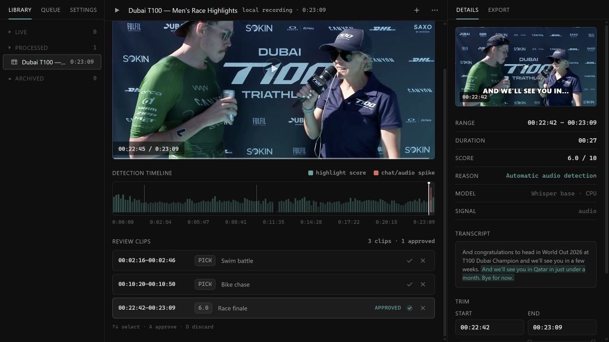

# ClipForge

### Highlight discovery for long-form video

ClipForge turns a public YouTube or Twitch VOD URL into scored, timestamped highlight candidates with transcripts. It combines audience signals and audio analysis, then transcribes selected windows on CPU so an editor can review promising moments without watching the entire recording.


**Working backend prototype · Real YouTube processing verified · Browser review interface · Tauri shell included**

[Demo gallery](docs/demo/README.md) · [Verified run](#verified-results) · [Run locally](#run-locally) · [Backend documentation](backend/README.md)



*Demo presentation using real source frames and transcripts from a local race recording. The swim and bike segments are editorial picks; the finale is an automatic audio candidate. The screenshot copy uses still previews. See [demo provenance](docs/demo/README.md#how-the-demo-was-made) for the distinction between the presentation and the running application.*

## The problem

A long recording can contain a handful of moments worth editing, but finding them usually means scrubbing through the whole source. ClipForge narrows that review to candidate windows and gives each one a timestamp, heuristic score, detection reason and transcript.

The project focuses on the discovery and review step: **which moments should an editor inspect next?** The URL pipeline fetches metadata, chat and audio-only media rather than downloading the full video stream.

## What it does

- **Background ingestion:** submit a URL, receive a job ID immediately, and poll processing stages through FastAPI.
- **Multiple detection signals:** chat-rate spikes, YouTube replay heatmaps, timestamped comment clusters and sustained audio-loudness peaks.
- **Candidate fusion:** merge nearby windows and increase confidence when different signals agree.
- **Targeted transcription:** extract only candidate windows as mono WAVs and transcribe them with faster-whisper `base`, CPU `int8`.
- **Review interface:** inspect the timeline, source range, score, reason and transcript; approve or discard candidates in the UI.
- **Bounded processing:** cap the analysis horizon and padded transcription windows, with separate jobs for different URL/limit combinations.
- **Repeatable verification:** an offline HTTP/background-job smoke test and a real-URL verifier that requires nonempty transcripts.

## Demo clips

Three excerpts from the supplied Dubai T100 men's race highlights recording. Click a preview or a video link to open the MP4.

| Swim battle | Bike chase | Race finale |
|---|---|---|
| [](docs/demo/clips/swim.mp4) | [](docs/demo/clips/bike.mp4) | [](docs/demo/clips/finish.mp4) |
| [Watch / download · 30s](docs/demo/clips/swim.mp4) | [Watch / download · 30s](docs/demo/clips/bike.mp4) | [Watch / download · 27s](docs/demo/clips/finish.mp4) |
| 02:16–02:46 · Editorial pick | 10:20–10:50 · Editorial pick | 22:42–23:09 · Audio detection, score 6.0 |

The gallery contains **17 PNG images**, **3 H.264/AAC clips**, and matching transcripts and SRT captions. The sample MP4s were cut separately with FFmpeg; they are media assets, not evidence of an implemented app export feature. ASR output is unedited and can contain recognition errors.

[Browse all screenshots, source stills and captions →](docs/demo/README.md)

## Architecture

```text
YouTube / Twitch URL
        │
        ▼
FastAPI ingest → in-memory job → background worker
        │
        ├── Metadata, chat replay, replay heatmap, timestamped comments
        └── Audio-only stream → FFmpeg PCM → RMS envelope
                                      │
                                      ▼
                         Score peaks → fuse candidate windows
                                      │
                                      ▼
                         Extract candidate WAVs → Whisper ASR
                                      │
                                      ▼
                         Job API → browser timeline and review
```

The service exposes stage progress, per-stage timings and signal/transcription warnings. The frontend retrieves job summaries and completed candidate datasets from the API. Jobs currently live in process memory.

### Engineering decisions

| Decision | Implementation and tradeoff |
|---|---|
| Analyze audio without fetching the full video | yt-dlp resolves an audio-only stream; bundled FFmpeg decodes it to PCM. This reduces media transfer, while long analysis horizons still require processing time. |
| Make peaks interpretable | Per-second RMS values are aggregated into 15-second bins and scored with rolling statistics. The default peak threshold is 2.5 standard deviations; scores are heuristics rather than learned quality predictions. |
| Combine independent signals | Nearby candidate windows are merged; agreement between different signals adds a capped score bonus. Audience metadata can help when loudness alone misses a moment. |
| Limit speech-recognition work | Whisper transcribes candidate windows with a small padding interval instead of the full VOD. CPU `int8` inference runs without requiring a GPU. |
| Make setup reproducible | The requirements include FFmpeg and ASR runtime packages, tested version constraints and `av==16.1.0` for the verified faster-whisper decoding path. |
| Verify behavior across the API boundary | The smoke test submits an actual HTTP job and exercises the background thread, FFmpeg decoding, detection, fusion and WAV extraction with a deterministic fixture. |

## Verified results

The public URL path was verified on **Windows / Python 3.11.18**, through API submission, polling, candidate generation, real audio extraction and Whisper transcription. The browser also displayed the live job's returned candidates and transcript.

| Check | Observed result |
|---|---|
| Public source | [Steve Jobs' Stanford commencement address](https://www.youtube.com/watch?v=UF8uR6Z6KLc) |
| Processing horizon | First 300 seconds |
| Fresh job wall time | 44.61 seconds |
| Returned candidates | 4; all 4 had nonempty transcripts |
| Highest-scoring candidate | 00:57–01:27, score 9.0, replay-heatmap signal |
| Job warnings | None in this run |
| Independent fresh pip environment | Health, dependency checks and offline tests passed; a real run returned 3/4 nonempty transcripts in 80.91s, with one ASR allocation warning |

These are individual observed runs, not throughput benchmarks. Timing and candidate availability depend on hardware, model cache, source content and platform access. The independent run's warning occurred while multiple verification servers had models loaded; that is an observed condition, not a confirmed diagnosis.

The [saved successful API response](docs/verification/youtube-run.json) includes the timestamps, scores, transcripts and stage timings. The [backend notes](backend/README.md#repeatable-verification) record test coverage and failed attempts that were not counted as passes.

## Run locally

The commands below target **Windows PowerShell with Python 3.11 installed**. Run them from the repository root. The browser demo does not require Node or a desktop build.

### 1. Install the backend

```powershell
git clone https://github.com/PIGJET/autoclipnew.git
cd autoclipnew
py -3.11 -m venv backend\.venv
.\backend\.venv\Scripts\python.exe -m pip install -r backend\requirements.txt
.\backend\.venv\Scripts\python.exe -m pip check
```

FFmpeg is supplied by the `imageio-ffmpeg` wheel. No system-wide FFmpeg installation is required. The first transcription downloads Whisper `base` weights from Hugging Face, roughly 150 MB plus supporting files. Allow extra time and a writable cache; `/api/health` does not download or load the model. Set `HF_HOME` before starting the API to choose a cache location.

### 2. Start the API

```powershell
$env:CLIPFORGE_LIMIT = '300'
.\backend\.venv\Scripts\python.exe -m uvicorn server:app --app-dir backend --host 127.0.0.1 --port 8971
```

### 3. Serve the interface

In a second terminal, from the repository root:

```powershell
.\backend\.venv\Scripts\python.exe -m http.server 4173 --bind 127.0.0.1 --directory src
```

Open [http://localhost:4173](http://localhost:4173). Use `localhost` for the allowed frontend CORS origin. The initial screen contains mock examples. After a real job completes, select its title under **Processed** to load its API candidates; a populated initial screen alone is not evidence of a successful ingest.

### 4. Submit and verify a real job

In another terminal:

```powershell
Invoke-RestMethod http://127.0.0.1:8971/api/health
.\backend\.venv\Scripts\python.exe backend\verify_vod.py 'https://www.youtube.com/watch?v=UF8uR6Z6KLc' --limit 300 --output vod-result.json
```

The verifier submits the URL, polls stages and returns success only when the completed job includes at least one valid candidate with a finite positive score and a nonempty ASR transcript. A `complete` status by itself is insufficient. Restart the API to measure a fresh run: repeated URL + limit submissions can reuse an in-memory job.

## Tests

```powershell
.\backend\.venv\Scripts\python.exe -m unittest discover -s backend -p test_smoke.py -v
```

The two offline tests cover:

- HTTP submission and polling of a background job using a generated five-minute audio fixture.
- Real FFmpeg RMS analysis, candidate scoring/fusion and extraction of a valid 16 kHz mono WAV.
- An expected candidate at **147–177 seconds**, and exclusion of that peak with a shorter processing cap.
- URL/limit job separation and actionable FFmpeg extraction diagnostics with signed-source URLs removed.

Platform calls and Whisper inference are stubbed in this suite. The separate real-URL verifier covers platform access and actual transcription.

## API at a glance

| Route | Purpose |
|---|---|
| `GET /api/health` | Service health and job count |
| `POST /api/ingest?limit=300` | Submit `{ "url": "<public VOD URL>" }` and receive a job ID |
| `GET /api/videos` | List job summaries and processing status |
| `GET /api/videos/{id}` | Inspect candidates, transcripts, timeline, timings and warnings |

Stages: `ingesting → detecting → audio → transcribing → complete`, or `error`. Progress is reported per stage. See [the backend API contract](backend/README.md#api-surface) for response fields and detection details.

## Repository layout

```text
backend/
  server.py                 API, jobs, detection, fusion and transcription
  audio_analysis.py         FFmpeg stream analysis and candidate WAV extraction
  chat_source.py            Public chat-replay integrations
  test_smoke.py             Offline API/background-job tests
  verify_vod.py             Strict real-URL verification command
  requirements*.txt         Runtime dependencies and tested constraints
src/                        HTML, CSS and JavaScript review interface
src-tauri/                  Tauri 2 application shell
docs/demo/                  Screenshots, sample MP4s, source stills and captions
docs/verification/          Saved successful real-job response
```

## Current scope and next steps

The verified path is **public URL → background analysis → scored highlight → nonempty transcript → browser review**. Twitch integration is present, but the recorded real end-to-end verification above is for YouTube.

The project remains a prototype: jobs are not persisted, source integrations can change, and individual transcription failures are reported as warnings. Approval and discard are UI review states. Local-file acquisition in the media demo used a separate helper; the screenshots do not establish a working upload control. MP4 export from the application and desktop packaging have not been verified.

Potential next steps are durable job storage, controlled worker concurrency, stronger transcription retry behavior, and further real-source validation. Export and desktop distribution would follow that core path.
