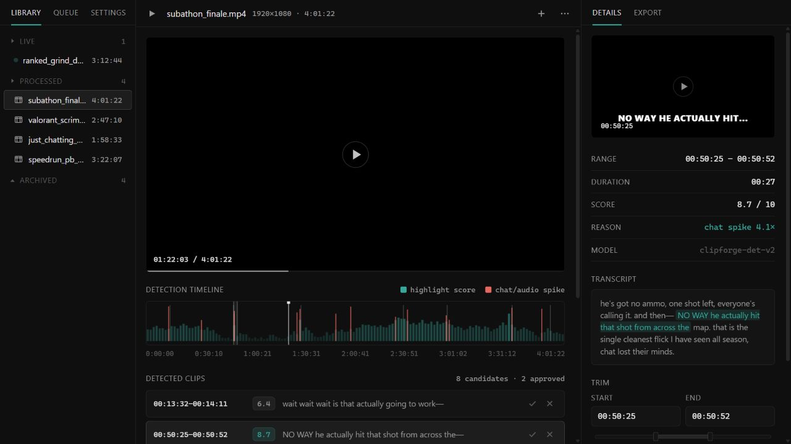

# ClipForge Pipeline

> A full-stack highlight discovery pipeline for YouTube and Twitch VODs—built to find the moments worth editing without downloading the full video.




## Overview

This version of ClipForge expands the desktop prototype into a real ingestion and analysis service. A YouTube or Twitch URL moves through metadata collection, chat and replay analysis, audio peak detection, signal fusion, and targeted transcription. Only lightweight metadata and audio are processed; the full video is never downloaded.

## Pipeline

```text
URL → metadata → chat / replay signals → audio envelope → signal fusion
    → candidate windows → targeted transcription → editor review
```

- **Metadata:** `yt-dlp` retrieves title, duration, uploader, formats, and replay heatmaps.
- **Audience signals:** chat density, replay peaks, and timestamped comment clusters reveal shared reactions.
- **Audio signals:** FFmpeg streams audio-only media into a rolling RMS loudness analysis.
- **Fusion:** nearby candidates merge, with a score bonus when independent signals agree.
- **Transcription:** `faster-whisper` transcribes only the selected candidate windows on CPU.
- **API:** FastAPI exposes asynchronous ingest jobs, progress, timelines, candidates, and health state.

## Tech stack

| Layer | Technology |
| --- | --- |
| Desktop UI | Tauri 2, vanilla JavaScript, HTML, CSS |
| Service | Python 3.11, FastAPI, Uvicorn |
| Media | yt-dlp, FFmpeg via `imageio-ffmpeg` |
| Speech | faster-whisper, CPU int8 |
| Sources | YouTube and Twitch public metadata/chat endpoints |

## Run locally

Create the backend environment from the repository root:

```powershell
py -3.11 -m venv backend\.venv
.\backend\.venv\Scripts\python.exe -m pip install -r backend\requirements.txt
.\backend\.venv\Scripts\python.exe -m pip check
```

Start the API:

```powershell
$env:CLIPFORGE_LIMIT = '300'
.\backend\.venv\Scripts\python.exe -m uvicorn server:app --app-dir backend --port 8971 --host 127.0.0.1
```

In a second terminal, serve the frontend:

```powershell
.\backend\.venv\Scripts\python.exe -m http.server 4173 --bind 127.0.0.1 --directory src
```

Open `http://localhost:4173` (use `localhost`, the allowed CORS origin).
The UI automatically connects to the local API, but initially shows mock clips.
Select the real video's title under **Processed** after its queue job completes
to display its API candidates and transcript. A populated mock screen is not a
successful ingest. Export remains prototype behavior.

Check health and run the bounded real demo from the repository root:

```powershell
Invoke-RestMethod http://127.0.0.1:8971/api/health
.\backend\.venv\Scripts\python.exe backend\verify_vod.py 'https://www.youtube.com/watch?v=UF8uR6Z6KLc' --limit 300 --output vod-result.json
```

The verifier submits `POST /api/ingest?limit=300`, polls the background job,
and exits successfully only with valid scored candidates and nonempty ASR
transcripts. Restart the API before measuring a fresh run: jobs are held in
memory and repeated URL + limit submissions reuse an existing job.

The first transcription downloads the faster-whisper **base** model from
Hugging Face (roughly 150 MB of weights, plus supporting files) into the user's
HF cache. Internet access and a writable cache are required; model download
time is additional to normal processing. `/api/health` does not load the model.
Later jobs reuse the cached model. See the backend README for cache settings.

Run the offline smoke test (no extra test dependencies):

```powershell
.\backend\.venv\Scripts\python.exe -m unittest discover -s backend -p test_smoke.py -v
```

This tests real HTTP submission/polling, background execution, deterministic
five-minute audio generation, actual bundled FFmpeg RMS analysis and candidate
WAV extraction, scoring/fusion, and a candidate at 147–177s. Platform calls and
Whisper inference are stubbed, so it runs offline and does **not** prove real
ASR or platform availability. It also checks that a shorter limit excludes the
peak and does not reuse the longer job.

Verified on Windows / Python 3.11.18 on November 16, 2026: clean requirements
install, health, offline smoke test, and real YouTube speech processing. The
final fresh demo took **44.61 seconds** with a **300-second** cap and returned
**4/4 nonempty transcripts**. The best candidate was **00:57–01:27**, score
**9.0**. The browser displayed these live API candidates and their transcript.
Public platform availability and detected peaks can change.

See [`backend/README.md`](backend/README.md) for the endpoint contract, detection thresholds, and platform-specific behavior.
