# ClipForge demo gallery

**3 video clips · 17 PNG images · transcripts and SRT captions**

These assets use the supplied Dubai T100 men's race recording to present the highlight-review workflow. The interface captures contain real clip windows, source frames and automatically generated transcripts. Two windows are editorial selections; one comes from the original automatic detector.

## Review overview

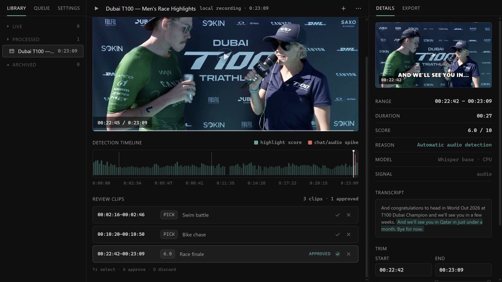

The two **PICK** badges identify manual selections. The automatically detected finale retains its heuristic audio score of **6.0**. The approval shown here is a local review action in the demo session.

## Video clips

| Clip | Source range | Duration | Selection | Files |
|---|---|---|---|---|
| Swim battle | 02:16–02:46 | 30s | Editorial pick | [MP4](clips/swim.mp4) · [Transcript](transcripts/swim.txt) · [SRT](transcripts/swim.srt) |
| Bike chase | 10:20–10:50 | 30s | Editorial pick | [MP4](clips/bike.mp4) · [Transcript](transcripts/bike.txt) · [SRT](transcripts/bike.srt) |
| Race finale | 22:42–23:09 | 27s | Automatic audio candidate | [MP4](clips/finish.mp4) · [Transcript](transcripts/finish.txt) · [SRT](transcripts/finish.srt) |

Each MP4 is 1280 × 720, H.264 video with AAC audio and fast-start playback. All three passed complete FFmpeg decoding and checks for duration, resolution, codecs and a nonempty transcript. See [media validation](media-validation.json) and [clip provenance](manifest.json).

## Swim review

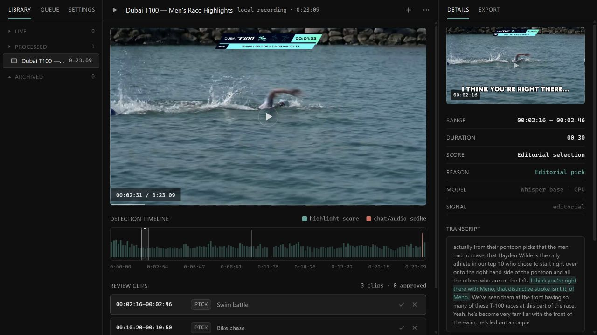

Transcript and selection details

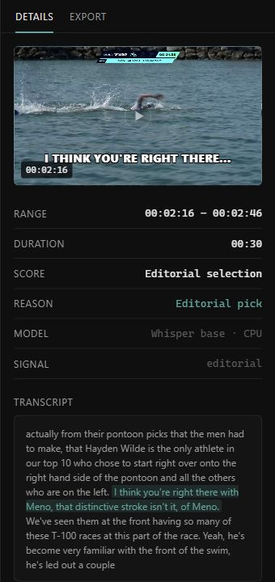

## Bike review

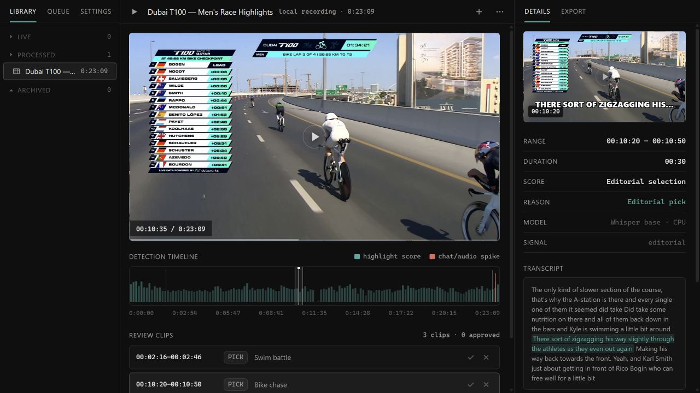

Transcript and selection details

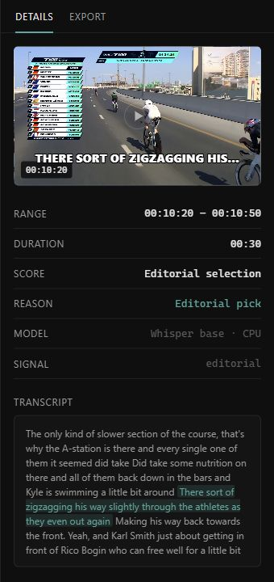

## Finale review

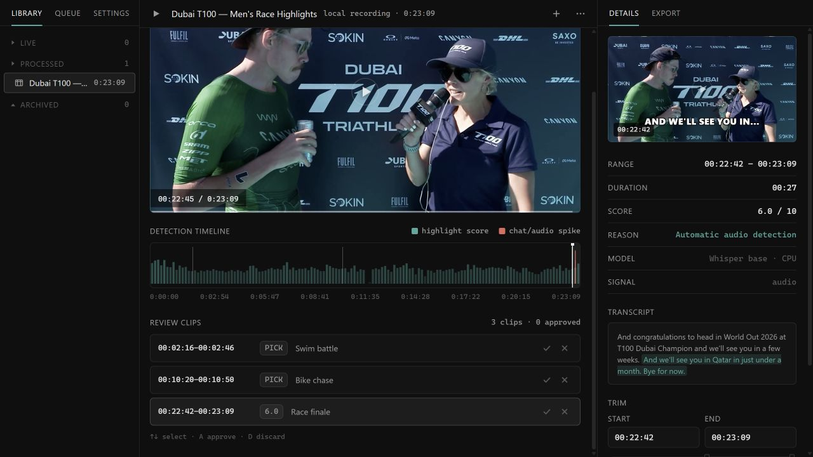

Audio score and transcript details

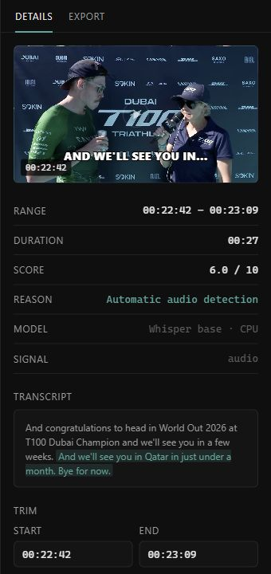

## Source stills

Nine 1920 × 1080 stills, sampled at three seconds into each clip, its midpoint, and three seconds before its end. The storyboard orders swim, bike and finale by row.

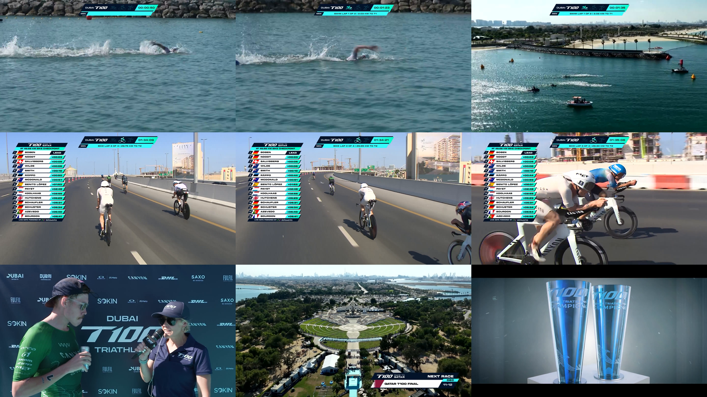

| Swim | Bike | Finale |
|---|---|---|
| [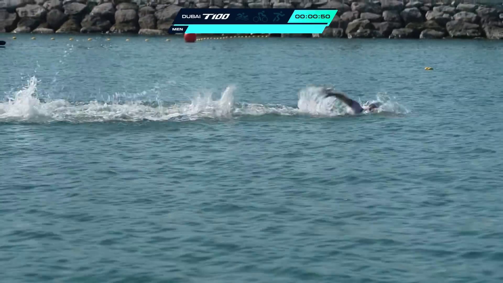](photos/swim-01.png) | [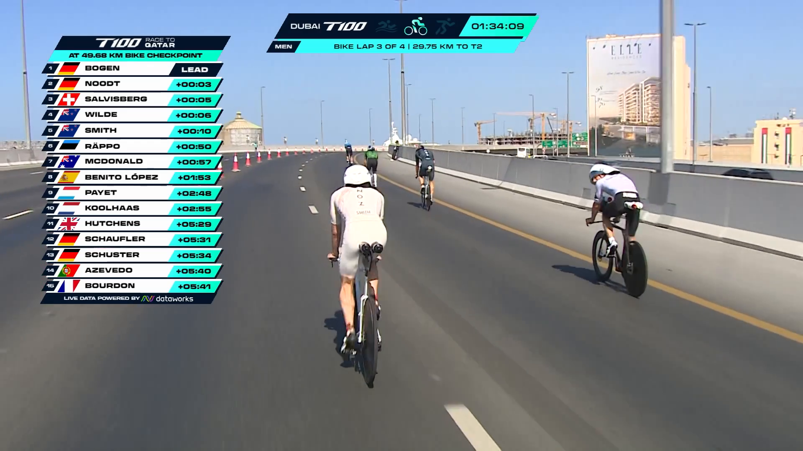](photos/bike-01.png) | [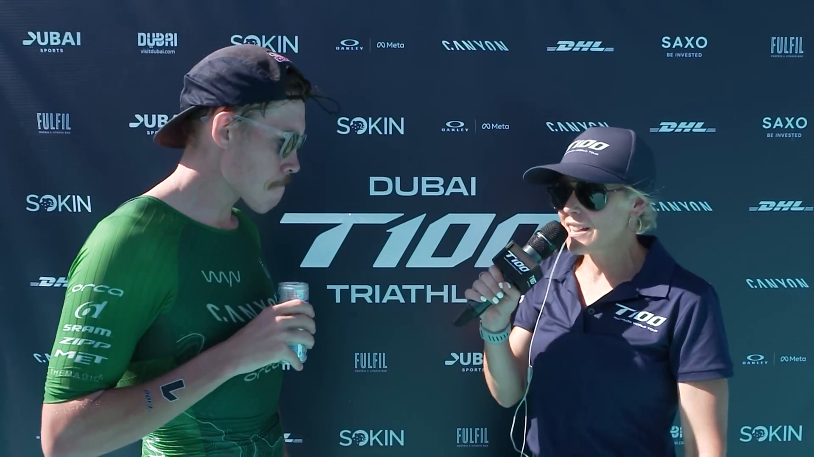](photos/finish-01.png) |
| [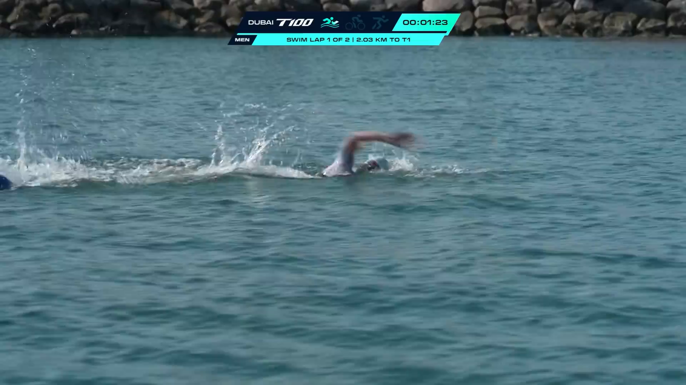](photos/swim-02.png) | [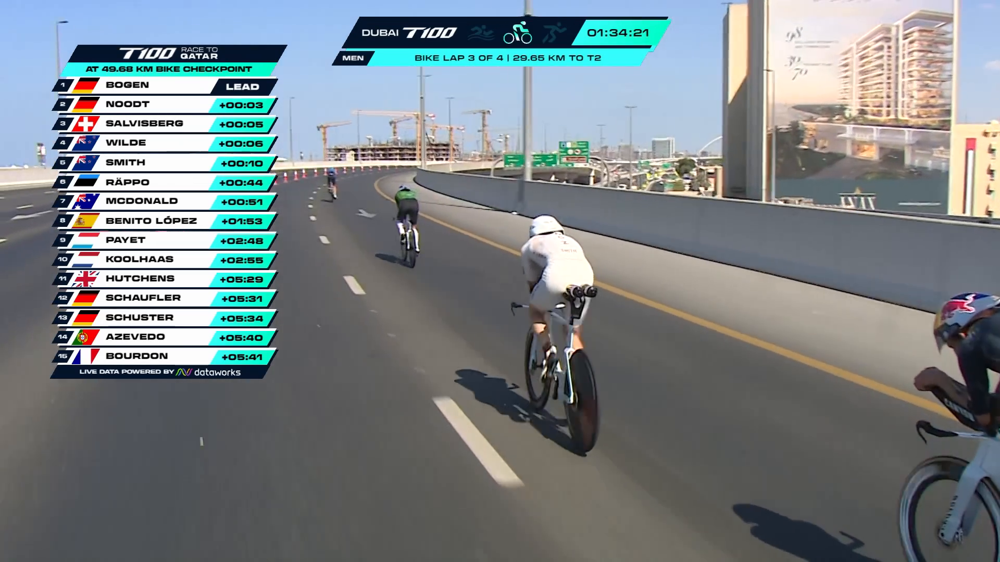](photos/bike-02.png) | [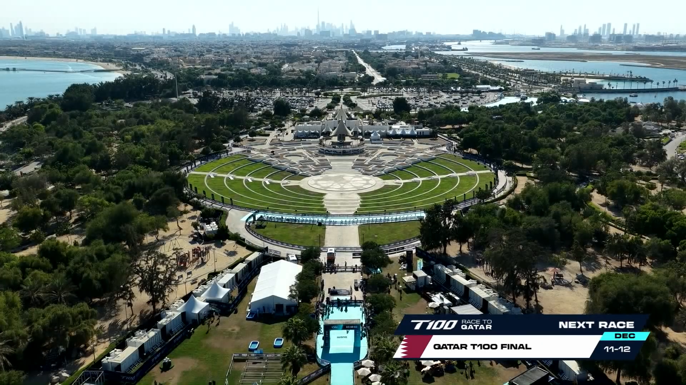](photos/finish-02.png) |
| [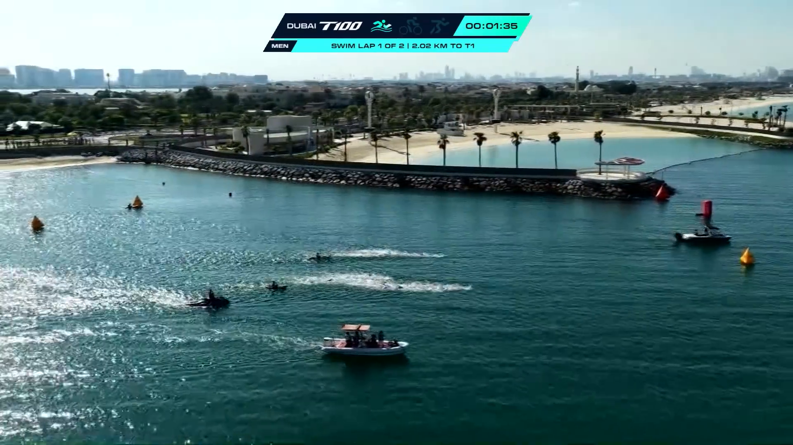](photos/swim-03.png) | [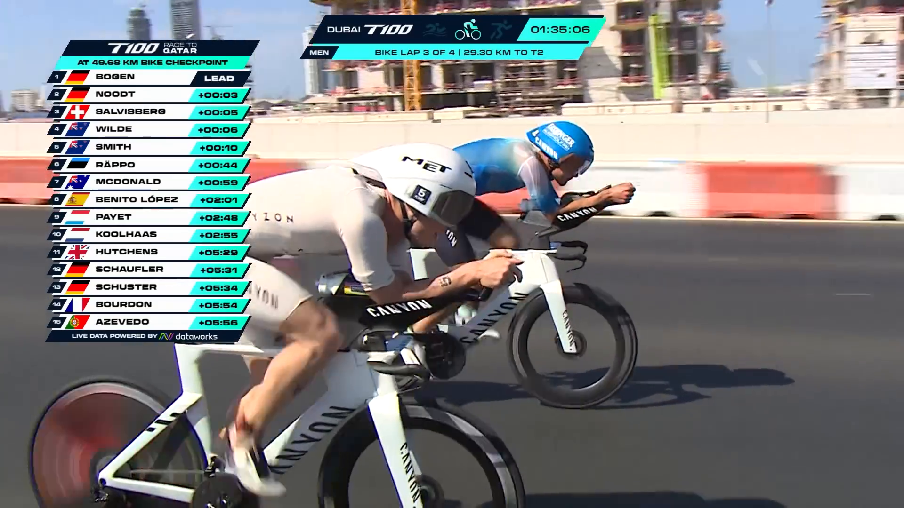](photos/bike-03.png) | [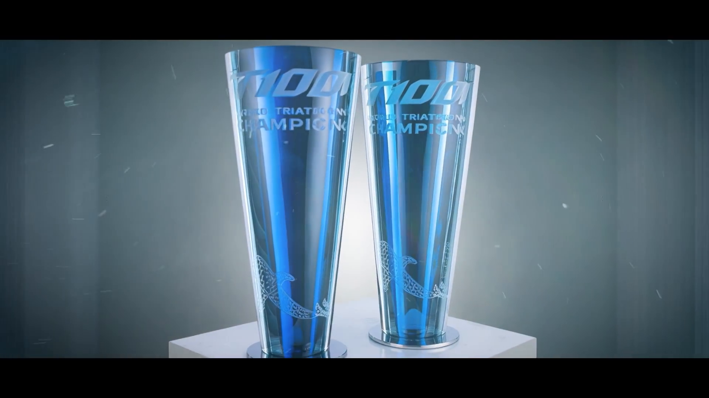](photos/finish-03.png) |

## How the demo was made

The original backend's FFmpeg RMS analysis, scoring/fusion, candidate WAV extraction and faster-whisper `base` transcription processed the full 23:09 local recording. It produced one automatic candidate at 22:42–23:09 in an observed 10.14-second run. Separate editorial selections provide swim and bike coverage. The three displayed windows were transcribed from the actual source audio; editorial picks were not assigned fabricated automatic scores.

The screenshots were captured from a disposable copy of the existing review interface populated with these saved results. That copy removed unrelated mock library entries, labeled editorial picks and displayed extracted stills. It used local-file acquisition instead of public platform calls. The sample MP4s were extracted separately using FFmpeg; these assets do not establish a working in-app upload control, video player or MP4 export path.

Transcripts and captions are unedited ASR output and include recognition errors, especially names. Some windows begin or end mid-sentence. The footage is from the supplied Dubai T100 men's race highlights recording; its broadcast branding remains visible.

[Back to the project overview](../../README.md)
